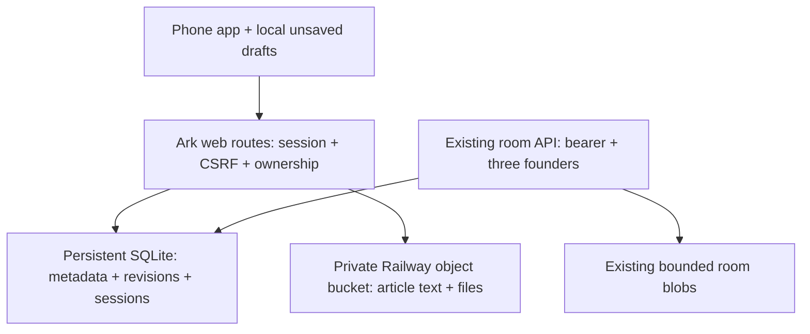

# Ark on your phone

October 8, 2026. Deployment: https://ark-core-testing.up.railway.app/app/

> “all my projects are sovereign” - Jah Noah, Q007

## Open and install

1. Open the URL in Chrome on Android or Safari on iPhone.
2. Choose **Install app** when offered. Otherwise use the browser menu's **Add to Home screen**; on iPhone use Share → Add to Home Screen.
3. Choose your private `operator-access.json` file. The standalone `Ark-Phone-Access.json` download contains the same credential, for easier phone import.
4. Write under **Writing**. **Save to Ark** creates a private revision. **Archive** shows stored files, uploads, downloads and allowance use.

The access file is a secret. Import sends it over HTTPS to this exact Ark server, then uses a Secure, HttpOnly cookie. The token is not saved in localStorage, IndexedDB, a URL or the service-worker cache. Initial credentials expire 30 days after the October 5 initialization; browser sessions last at most seven days and cease working if the underlying credential expires or is revoked. There is no email-code login yet.

## Writing

Create a blog or article draft. Add a title and your own text; Markdown toolbar controls support headings, bold, italics, quotes and lists. Preview renders those basic text formats without executing HTML or scripts. Save to Ark records an immutable revision in the private bucket. Revisions can load older text into the editor; saving then creates another revision. An outdated base produces a conflict and keeps your phone copy.

Unsaved text is stored in IndexedDB on this phone, under your account ID. It survives a reload and remains available offline after the app has loaded once. Clearing browser/app storage can remove unsaved phone copies; use Export Markdown to keep an independent copy. Signing out leaves account-specific local drafts on the phone and removes the remembered profile. Server saves and uploads require connectivity and a valid session. This release does not silently queue saves or merge concurrent edits.

Saving does not publish to OnlyJah or JahNoah websites. No publishing integration is included. The one initial **Ark notes** draft contains your exact Q008 quote, used to verify a real private bucket save/read; it is not published.

## Archive

The new private Railway object bucket is `ark-personal-archive` in the Ark Core testing environment. It was created October 8 because the previously discussed 5 GB archive was a proposed allowance, not an existing connected bucket. No files were migrated from another provider or device.

- Personal allowance: **5,000,000,000 bytes** (decimal 5 GB).
- One attachment: up to **25 MiB**; one article body: up to 1,000,000 UTF-8 bytes.
- Usage includes every saved article revision, attachment and pending reservation. The meter shows server records for the signed-in account. Failed cleanup keeps its reservation counted rather than understating use.
- Files are private, downloaded as attachments, and never served as executable HTML.
- The core's collaborative room object store remains separate, with its earlier 256 MiB ceiling and three-founder approval rule. Personal drafts do not create rooms or circumvent that rule.
- Lists are capped at 1,000 drafts/files and 100 revisions per history view. General pagination and archive deletion UI are future work.

Object bytes live in the bucket. SQLite ownership, version metadata and hashed sessions live on the existing 512 MB persistent volume. The allowance is enforced by the application; it is not a prepaid storage purchase. Railway storage/egress follows your account billing.

## Topology



## Implementation and verification

`web/` is a buildless, independently reusable static client. `src/web.ts` implements the same-origin browser API. `scripts/build-railway.ts` embeds static assets and the server into the Railway Function, while retaining the existing room API.

Browser writes need both the configured exact Origin and the per-session CSRF value. Every draft/file read verifies owner identity on the server. Session authorization rechecks credential expiry/revocation on every request. Quota reservations occur in a SQLite transaction before upload. Save commit rechecks the head after upload to reject concurrent overwrites. The service worker caches only explicitly listed static shell assets, never API responses.

Six automated tests pass, including ownership isolation, restart persistence, CSRF denial, expired/revoked access, stale edits, quota rejection and failed-upload rollback. Live checks verified the app, manifest, unauthenticated denial, session login/logout, storage allowance and a private draft saved/read from the bucket. A browser engine was unavailable here, so home-screen installation and touch behavior still need verification on your actual phone.

This is assistant-written implementation documentation. Attributed quotes remain the user's exact text; no article has been generated or published on the user's behalf.

## Markdown library update

EasyMDE 2.21.0 (MIT) is now embedded for editing; Marked 18.1.0 (MIT) renders Markdown and DOMPurify 3.4.16 (Apache-2.0/MPL-2.0) sanitizes the HTML. The exact distributions and their licenses are in `web/vendor/`. Browser requests use your Ark origin, not a public CDN. The editor libraries are hash-pinned static assets in the private bucket and publicly served as application code; private documents use separate authenticated routes.

Use **Write**, **Read**, or **Split view**. The viewer supports tables, links, lists, headings, emphasis and fenced code. Raw HTML is sanitized; image embedding is disabled. Mermaid fences display their code rather than generating topology diagrams in this release. Local Markdown document links work when the target has also been imported.

The document list refreshes when you return to the app and every 15 seconds while visible and online. **Refresh** requests it immediately. A new server revision replaces the open document only while there are no unsaved edits; otherwise your local text stays intact and server saving still detects stale revisions. This is polling and version checks, not collaborative live editing.

**Import Markdown** accepts one or more `.md` files from your phone. To add documents directly without phone downloads, run from the repository root:

```sh
python3 examples/import-docs.py ../private-access/operator-access.json \
  docs/USER-GUIDE.md docs/PHONE-APP.md docs/API.md
```

Repeated imports have stable IDs and skip existing entries. Add `--update` only when you deliberately want a new revision from the local source. This adds files to your private Ark document library; it does not modify a GitHub repository, publish an article or automatically mirror all chat attachments. Engineering docs are labeled as implementation documentation; attributed quotations remain human originals.

Markdown UI verification uses the included pinned test dependencies: `npm ci --prefix test/markdown-ui`, then `node test/markdown-ui/check.cjs`. The browser-like DOM check covers EasyMDE loading, GFM tables/code/emphasis, sanitization, dirty-draft preservation and clean-revision refresh. It is not a device/touch test.
