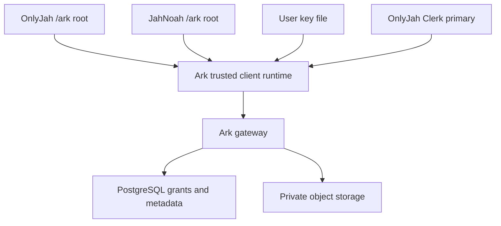

# Ark platform, 9 October 2026

> I want shadcdn used across both, a shared UI kit with templates and blocks.

Jah Noah, Q041, supplied 9 October request. Engineering interpretation: shadcn/ui, a separately versioned OnlyJah component library and site-owned root templates.

> Info is encrypted as it passes through to the client without the client site backend ever getting to read it unless granted permission by the user upon approving access to the client site to aspects of their data.

Jah Noah, Q042, supplied 9 October request. The following architecture and implementation details are engineering notes, not quotations.

## What exists

| Work | Status |
| --- | --- |
| Current phone archive, 5 GB quota, Markdown editor, immutable private revisions | Live, legacy SQLite metadata and private Railway S3 bucket |
| Document projects, nested folder paths, searchable vertical navigation, mobile collapse | Tested, staged for approval |
| Archive file project/folder assignments and search | Tested, staged for approval; moving metadata does not move or duplicate bytes |
| Public UUID snapshots, index, RSS and withdrawal | Tested, staged for approval; no existing documents were published |
| OnlyJah and JahNoah `/ark` overviews in their respective roots | Built locally, proposed source branches; current workspace still opens at its existing external origin |
| Versioned shadcn/Base UI kit | Independent local Git repository, 0.1.0 registry artifacts; remote repository and hosting still needed |
| Client-side key-file AES-GCM module and client-grant predicates | Implemented and tested, not wired into the live archive |
| Bun/Hono gateway, Clerk token verification adapter, PostgreSQL target schema | Source and generated single-file function; not deployed or migrated |
| Embedded private static clients, first-access grant popup, common account panel | Not implemented yet |
| Clerk primary/satellite domain configuration and org duties | Blocked by Clerk connection reauthentication; no identities or roles changed |
| Personal-bucket replica plans, database relationship explorer, email/webhook delivery | Not implemented; original collaborative-room replication remains separate |

## Boundary



This is the target, not a claim that all arrows are live. Root templates supply branding and purpose; blocks receive props. Public overview copy comes from `/app/client-copy.json`, with a checked-in versioned fallback. The static overview does not request private records.

A website that controls the JavaScript handling an unlock file can read that file and decrypted data. TLS alone does not prevent that. For protection from an untrusted host backend, unlock and decrypt inside an Ark-owned cross-origin runtime with a fixed, trusted origin; host framing cannot inspect that frame. Only deliberate, scoped messages may disclose data. Serving decryption code through a host-controlled same-origin proxy does not preserve that isolation. A registered site is not automatically a trusted decryption context.

The existing access JSON is an authentication credential. It is **not** a bucket encryption key. Existing drafts and attachments are not protected by the new client-side module until an explicit encrypted migration and restore check are completed. The current module handles bounded buffers; chunked large-file encryption and resumable uploads are still needed for large videos. No plaintext decryption broker or key escrow is deployed.

## Code

```ts
import { createUnlockFile, unlock, seal, open } from './packages/crypto/src/index.ts'
const file = await createUnlockFile() // download privately; never upload this file
const key = await unlock(file)       // non-extractable imported browser key
const context = { ownerId, bucketId, objectId, revisionId }
const envelope = await seal(key, file.keyId, new TextEncoder().encode(markdown), context)
// A relay may store envelope; it does not receive key or file.
const plaintext = await open(key, file.keyId, envelope, context)
```

AES-GCM authenticates owner, bucket, object and revision as additional data. Changing any binding, using another key or modifying ciphertext fails authentication. This module is a building block, not a reviewed complete vault. Do not place unlock files in IndexedDB, cookies, telemetry, build envs or repository commits.

`packages/contracts` supplies shared types and exact-origin grant checks. `apps/gateway` supplies a Hono boundary for registered clients, verified Clerk sessions, owner-scoped grants and ciphertext reads. Consent writes/revocation are restricted to the primary account origin. Scopes expire, can be revoked and never arise from a display name or org membership. Plaintext grants and cipher uploads are intentionally not activated by this gateway prototype; UI and auditing integration remain required.

```sh
npm ci
npm test
npm run typecheck:platform
npm run check:quotes
npm run build:railway
npm run build:gateway
```

`railway/platform.manifest.json` records exact existing project/environment/service IDs and additive target services. It is a planning manifest, not an automatic Railway deployment schema. `migrations/001-platform.sql` is a new PostgreSQL target, not a migration of current SQLite data and not an instruction to alter OnlyJah's existing Neon tables. Do not retire SQLite until every current identity, credential, document, revision, object and publication mapping is migrated and a restore test passes.

## Identity and organizations

Clerk cross-domain session sharing requires one application with OnlyJah as the primary domain and JahNoah as a configured satellite. Organizations describe membership and duties inside that application; creating two org names alone does not configure SSO. Use exact verified Clerk subjects and org IDs for JahNoah admin duties or Keon's ViibePass manager role. None were verified in this run and none were assigned.

ViibePass can have separately scoped organizations in the same application. A genuinely separate private user pool in another Clerk application requires an explicit identity-link/federation design; it does not automatically share the same Clerk subject or satellite session. Determine that boundary before inviting anyone or widening access.

Provider references: [Clerk satellite domains](https://clerk.com/docs/guides/dashboard/dns-domains/satellite-domains), [shadcn namespaces](https://ui.shadcn.com/docs/registry/namespace), [Railway Functions](https://docs.railway.com/functions), [Bun SQL](https://bun.com/docs/runtime/sql).

## After the staged phone update is approved

Use Documents & projects to collapse navigation on a phone. Create a project, save a document, select its project and enter a path such as `research/sync`, then Move. Search matches titles, source paths and folder names; batches render 100 documents, with Show 100 more. The server currently lists at most 1,000 documents and files; full server-side pagination remains needed beyond that scale.

In Archive, choose a target project/folder and press Move beside a file. The stored bytes and quota stay unchanged. Save writing privately as before. Publish snapshot explicitly makes the current saved revision readable by anyone at `/p/UUID`; later saves do not change it. Existing snapshots appear when reopening the document and can be withdrawn. Withdrawn content returns HTTP 410. Public `/publications`, `/publications/UUID`, `/publications/UUID.md` and `/feed.xml` are link targets; no RSS subscriber, email or webhook is sent automatically. Public content may already have been copied by readers.

Permanent links currently use the configured Ark service origin. Preserve UUIDs and redirects when adding custom domains; do not derive IDs from titles or folder paths. Durable redirects and a canonical custom-domain decision remain deployment work.

## Validation and blockers

Nine Ark tests pass; platform types and exact quote references pass. The browser-like editor test covers sanitized Markdown, dirty draft refresh, a 160-document tree, bounded rendering, search and collapse. OnlyJah passes its testing build, typecheck, 53 tests, 86 static pages and direct/slash URL smoke checks. JahNoah builds 18 static pages including `/ark`. A real browser engine could not be downloaded, so physical viewport/keyboard visual QA is still pending.

Automatic approval review rejected immediate live replacement of the Ark function, citing disruption risk to the private archive and insufficient specific cutover authorization. The tested replacement is staged in Railway testing. No PostgreSQL service, domain/DNS mutation or live site deployment was performed. Clerk's connection must be reauthenticated before verifying its configuration. The GitHub connector does not expose repository creation, so the separate UI repository is packaged for creation rather than falsely claimed to exist remotely.
