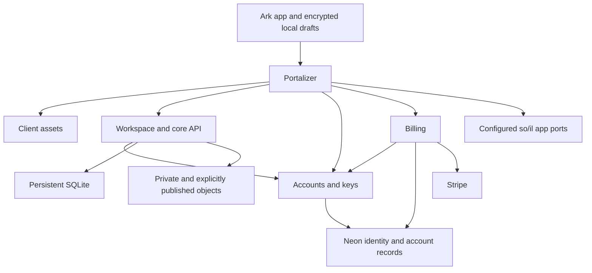

# Ark service refactor and Portalizer

Implementation version 0.2.0, October 10, 2026. Engineering documentation; product/editorial wording remains the author's supplied wording.

Release state: the compact refactor is staged in Railway as 34 changes on Ark Core only, patch `7ecd5ded-adc3-42c5-80d7-b28c3125f9ee`. The deployment commit was rejected with “Cancelled — the user did not approve this action.” No modular release is confirmed live. No additional service or plan upgrade was applied.

Five independently runnable services now share explicit HTTP contracts. The default compact profile composes the same service factories in one process to retain the existing Railway footprint. A folder boundary in that profile is not a security sandbox: process memory and the operator's environment remain shared. Separate containers with separately assigned credentials provide the operational separation.



| Folder / service | Responsibility | Credentials and persistence |
|---|---|---|
| `services/portalizer` | Public ingress, bounded forwarding, configuration aggregation, port listing and invocation | Destination/app portal keys; no database, Stripe or archive credentials |
| `services/client` | PWA shell, editor, encryption client, bundled static libraries and publication reader | Public auth URL and its incoming portal key; no database or user private keys |
| `services/workspace` | Personal documents/projects/folders, revisions, receipts, public snapshots, room API | Existing SQLite volume and S3 credentials; its portal key and account-verification key |
| `services/accounts` | Provider JWT verification, current user checks, entitlements, encrypted key backups and signature verification | Scoped Neon URL; incoming keys for gateway, workspace, billing and Portalizer |
| `services/billing` | Checkout, claims, webhook receipts/reconciliation and billing portal | Scoped Neon purchase/event URL, Stripe key and webhook secret; its portal key and account-verification key |
| `packages/core` | Room governance, resource authorization, operation receipts and persistence | Instantiated only by workspace or the original core CLI |
| `packages/sync` | Pure local-first synchronization state machine | No server state |
| `packages/billing` | Pure entitlement and claim predicates | No credentials |
| `packages/http` | Bounded requests, origin checks and the HTTP server adapter | No provider state |
| `plugins/so-il` | Portal registration contract, scoped request authority, recipient checks and invocation helper | Port-specific signing key; never user identity tokens at recipient apps |
| `src` | Compatibility imports and existing CLI/peer tools | Existing imports continue to resolve |

## Route and server spread

Only Portalizer needs a public domain in the split profile. Backend HTTP ports remain private. Each backend exposes only a minimal `/health` response without a grant; private routes require valid portal authority.

| Public entry | Destination | Final authorization |
|---|---|---|
| `/app/`, assets, `/p/{publication}` | Client | Static/public content; private APIs are separate |
| `/app/api/config` | Accounts + billing status | Public connection/readiness information only |
| `/app/api/account/keys` | Accounts | Verified OnlyJah identity; paid entitlement for initial key creation |
| `/app/api/billing/*` | Billing | Verified session when required; raw Stripe signature for webhook; verified email for claim |
| Other `/app/api/*` | Workspace | Managed session or legacy access-file session; owner checks and paid write checks |
| `/v1/*` | Workspace core API | Existing enrolled credentials and room/resource permissions |
| `/publications`, `/publications/{id}`, `/feed.xml` | Workspace | Explicit published snapshots only |
| `/ports` | Portalizer | Current session, requested app, configured owner/member ceiling |
| `/ports/{port-id}` | Configured destination | Current verified session, configured app/method/resource, then recipient's own scope check |

The identity provider's signup/login remains directly between the browser and managed Neon Better Auth. Portalizer is not an identity provider. Accounts verifies provider-issued tokens and checks current database identity state before granting member access.

## Portalizer and so/il contract

The name **so/il** is preserved as requested; no expansion of the name is assumed. A port entry is an operator-defined application/resource capability, not an arbitrary URL proxy or operating-system socket controller. Version 1 registers exact destinations through `ARK_PORT_ENTRIES`. It does not expose a public registration API.

Each entry declares `id`, `app`, `audience`, `owner`, `resource`, `destination`, `action`, permitted `methods`, optional explicitly authorized `subjects`, optional `maxBytes`, and a private `secret`. The destination is fixed in configuration. Caller query strings cannot substitute another destination. Embedded URL credentials and duplicate port IDs are rejected. `x-ark-app-id` selects a configured application ceiling; it is not an OAuth client credential or independent proof of app identity. This version supports same-origin Ark app requests. Cross-origin app OAuth enrollment is future work.

On invocation, Portalizer verifies the user's current OnlyJah session and the registered app's owner/member/method ceiling. It issues a grant containing app, audience, user subject, owner, resource, action, expiry, nonce and request digest. The digest binds the method, path/query, body and forwarded security headers. Expiry is at most 30 seconds and never beyond the verified identity JWT's expiry.

Recipient apps receive the signed authority header, not the user's login token or cookies. The recipient must use `protectPortal` and `assertPortScope` to match its locally owned resource and requested operation before reading or mutating data. The signature is an HMAC-SHA256 service transport capability, distinct from the member's asymmetric vault keypairs. Keys are unique per destination and, for account RPCs, per calling service; a workspace key cannot impersonate the gateway's key-management capability.

```ts
import { protectPortal, assertPortScope } from '../plugins/so-il/index.ts';

const scope = {
  app: 'forge', audience: 'notes', owner: configuredOwner,
  resource: configuredDocumentId, action: 'document.read'
};
const fetch = protectPortal(portKey, 'notes', async (request, grant) => {
  assertPortScope(grant, scope);
  if (request.method !== 'GET') return new Response(null, {status: 405});
  // Resolve this exact resource in this application's own authorized store.
  return new Response(await readCiphertext(scope.resource));
});
```

The browser can use `invokePort(origin, portId, appId, freshIdentityToken, options)`. No port signing key belongs in browser code. Do not embed private destination keys in public contract examples or logs.

Replay protection is bounded and process-local. Private state mutations still need their existing persistent operation IDs/receipts; a replay cache is not distributed exactly-once delivery. With multiple recipient replicas, use a shared nonce store or rely on an idempotent operation contract before enabling writes. Portal entries currently use explicit subjects, not organization role-graph queries. JWTs and issued grants have short expiry; immediate cross-app session revocation, page-specific reauthentication, refreshable grants and federation discovery are not implemented.

## Database boundaries

No existing tables or data were renamed, migrated or deleted by the refactor.

| Store/table family | Owner | Purpose |
|---|---|---|
| Provider `neon_auth."user"` selected columns | Neon; accounts reads only | Current identity, verified email and banned state |
| `ark_kash.accounts` | Accounts | App account linkage |
| `ark_kash.key_envelopes` | Accounts | Encrypted private-key bundle and public verification keys |
| `ark_kash.purchases` | Billing writes; accounts reads entitlement columns | Customer/subscription/claim state and paid period |
| `ark_kash.webhook_events` | Billing | Verified Stripe event receipts |
| SQLite core tables | Workspace | Node identity, enrollment, rooms, charters, memberships, revisions and recovery |
| SQLite `web_*` tables | Workspace | Documents/projects/folders, objects, public snapshots and mutation receipts |
| Private S3 prefixes | Workspace | Ciphertext plus deliberately public copies under published prefix |

`migrations/001-ark-kash.sql` remains the account schema. Optional `002-service-roles.sql` defines NOLOGIN privilege groups for accounts and billing. It has not been applied to a provider. An operator must create separate LOGIN roles with strong private passwords, grant only the corresponding group, and set the resulting URLs as `ARK_ACCOUNTS_DATABASE_URL` and `ARK_BILLING_DATABASE_URL`. Do not grant session-table reads, schema ownership or `neon_superuser`. The compact profile accepts the existing `ARK_DATABASE_URL` for compatibility. Workspace and client do not construct a Postgres client.

The shared purchase table is an intentional small integration surface, not a permission grant to every app. Metadata remains on one SQLite writer; this refactor does not make that store horizontally scalable. Move that adapter to Postgres before adding workspace replicas. A paid member still receives a logical allocation in the existing private object bucket, not a new physical bucket or database per user.

## Budget and deployment profiles

**Compact is the default.** The existing Railway Ark Core service can run all five handlers in one container with one SQLite volume. No extra service, database, bucket, region or replica is required. Module configuration is filtered, but a compromised compact process can still read process-wide memory/environment; isolation requires the split profile.

**Split is opt-in.** `deploy/compose.split.yaml` runs the five independently built services behind Portalizer, exposes only gateway loopback port 8080 and requires the existing archive volume by explicit name. Its configured memory ceilings sum to 698 MiB and CPU ceilings to 1.5; these are resource limits, not a price or guaranteed monthly budget. Railway usage is billed across services. This profile has not been provisioned or billed here. Retain compact until a measured workspace budget justifies splitting.

For Railway split deployment, use the same repo/image in five services, selecting `bun /app/{service}.mjs` as the start command. Attach the existing data volume only to workspace, configure private HTTP destinations and grant each service only the credentials in the table above. Generate a domain only for Portalizer. Do not move a mounted volume while the old writer is still active. Take a tested snapshot and stop the old writer before transferring its mount. A second empty volume would create a second archive, not migrate the first one.

The full server bundle still exists for compact Docker use and testing. Railway Functions must use the small `railway/loader.function.ts` plus `railway/release-variables.json`; never paste the large full bundle into a startup command. `npm run build` regenerates all five deployable files, the compact bundle, the hash-checked loader and bounded release variables.

## Verification and limits

The Node suite passes 22 tests, with the Bun-only loader test skipped. Bun 1.4.0 passes eight selected service/portal/loader tests. Split-service integration uses real loopback HTTP requests and verifies existing operator login, private backend denial, config aggregation, fail-closed billing and cross-service key separation. Browser-like Markdown and encrypted-vault sync checks pass.

Docker is unavailable here, so image builds and Compose orchestration remain unverified. Managed signup/payment and the full private encrypted document RPC have not been tested against real provider accounts after this refactor. No Android APK or full browser/mobile visual check was added. No new Railway service or provider migration was applied. The deployment approval tool remains blocked; an updated staged compact release must not be described as live without a successful deployment and endpoint check.
