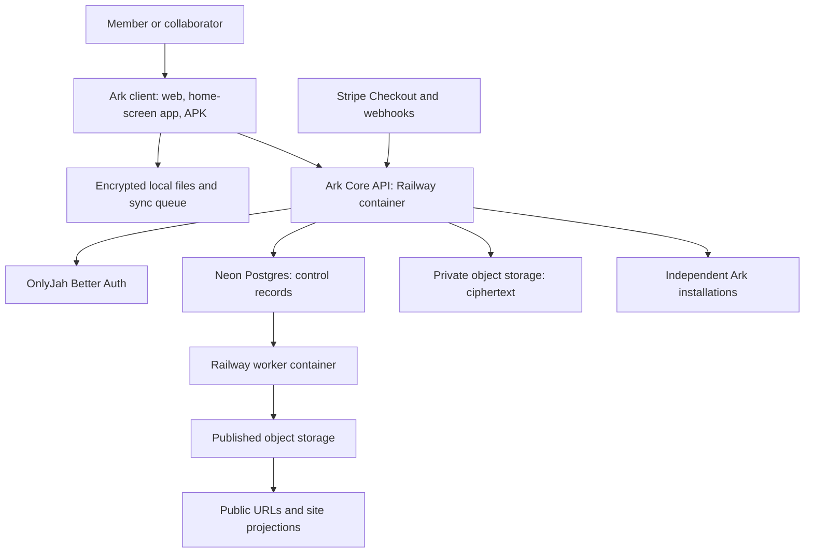
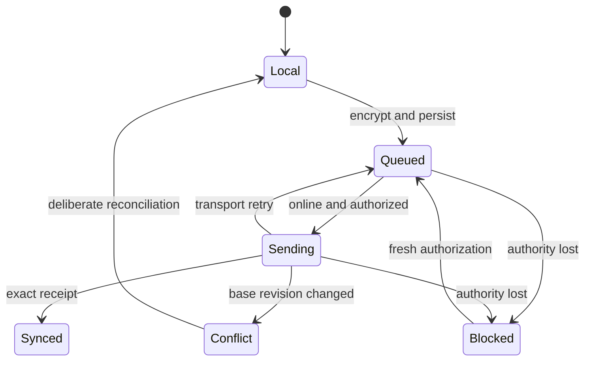

> Retained TypeScript/Bun profile. For the Go migration, start with [BUILD.md](BUILD.md), [KASH-GO.md](KASH-GO.md), and [GIT-DEPLOY.md](GIT-DEPLOY.md).

> Current implementation: [Portalizer and service refactor, version 0.2.0](PORTALIZER.md). Earlier topology/deployment notes below describe the preceding pilot or future plans. The full-source Railway Function startup command is superseded by the bounded loader.

# Current implementation update

See [OVERHAUL-2026-10-10.md](OVERHAUL-2026-10-10.md) for shipped source, provider setup and limits. The original design below remains the target; the staged implementation now includes accounts/billing, encrypted document content, key backups and the active-document save queue. It is not deployed yet.

# Ark: first voyage into the Anu

System topology and programming breakdown. October 10, 2026.

Status: implementation has started against the existing October 8 pilot source. The deployment below is the target, not a claim that Better Auth, billing, encryption or automatic sync is live.

## Mission and product boundary

Author's exact framing:

> Consciousness: OnlyJah's teams and members
> Vessel: Ark-Core, (+Infrastructure, +Applications)
> Spirit: Initiatives, MVP, Commerce
>
> OnlyJah - Digital workspaces for creative partnerships!
>
> Join Today!

OnlyJah charters this repository for the first voyage into the Anu. The launch product is Ark Kash: a local-first Markdown workspace with a $20 monthly paid authoring/storage tier, authorized free collaboration, and deliberate public publishing. Ark Core is the portable container connecting accounts, permissions, applications and resource homes. Engineering prose is implementation assistance, not public editorial copy.

Ship this sequence: sign in/purchase -> provision private workspace -> unlock keys -> create locally -> synchronize encrypted revisions -> share deliberately -> publish an exact revision. Broader creative applications attach to that contract afterward.

## 1. Physical topology

This is a logical data-flow graph. The worker also reads/writes Postgres and approved public objects. Authorized ciphertext transfers may use short-lived signed URLs directly from the client; authorization and quota reservation still run through Ark.

| Deployable | Launch host | Responsibility | Persistence |
| --- | --- | --- | --- |
| Ark client | Railway initially; reusable static build | Responsive editing, local crypto, local storage, sync, public viewer | Device database; no server credentials |
| Ark Core API | Railway OCI/container image | Verified sessions, resource authorization, quotas, signed transfers, mutation receipts | Postgres; runtime scratch is disposable |
| Ark worker | Railway, same codebase with separate entrypoint | Provisioning, durable retries, public release delivery, cleanup | Postgres job/outbox state |
| Identity | Existing OnlyJah Neon-managed Better Auth, once verified | Login and account identity | Provider-managed auth tables |
| Coordination database | Neon near Railway API region | Metadata, memberships, entitlements, keys, revisions, operations | Postgres plus tested recovery |
| Private object storage | Railway S3-compatible bucket initially | Encrypted Markdown/attachments/revisions | Durable objects plus independent recovery |
| Published object storage | Separate Railway bucket initially | Explicitly public approved snapshots | Immutable version objects and public manifest |
| Optional applications | Their own container/service | Creative tools, integrations, later OpenCloud | Their own adapters and grants |
| Independent Ark node | Any supported container host | Owner-controlled resource home and authorized bridges | Local/hosted database and object adapter |

Railway API-to-Neon traffic uses external TLS; it is not Railway private networking. Keeping API/worker in one Railway project environment allows private communication between those services. Containers do not make every server platform compatible automatically: publish tested CPU/platform targets, required storage semantics, health checks and configuration.

## 2. Logical topology

| Boundary | Contains | Does not imply |
| --- | --- | --- |
| Account | A principal linked to verified issuer+subject | Paid status, organization ownership or room access |
| Paid workspace | Owner's private allocation and authoring entitlement | One physical server, bucket or database per user |
| Organization | Team, agreements and resource ownership | Universal access to every room |
| Room | Scoped resources, memberships and charter | A host or domain |
| Application | A UI/tool identity and capability ceiling | Access without user/session authority |
| Node | Durable installation ID and enrolled signing keys | Ownership of every connected resource |
| Publication | Explicit release of one revision to chosen destinations | Automatic publication of drafts or later edits |

OnlyJah and JahNoah can render different `/ark` landing pages and site framing while reaching the same instance. The shared UI kit supplies components; the API enforces access. Contract changes are versioned, and sites pin compatible client releases.

## 3. Purchase, account and storage provisioning

1. Welcome screen offers sign-in and $20/month purchase. Reuse existing OnlyJah accounts; do not merge accounts by email alone.
2. API creates Checkout from a configured Stripe recurring Price ID and a durable pending purchase reference. The browser cannot set price, allowance, ownership or payment status.
3. Verify the webhook signature against the raw body and deduplicate the provider event. Resolve its customer/subscription against the pending purchase and verified account identity.
4. Record billing state, then enqueue idempotent workspace provisioning. Paid authorization remains unavailable while provisioning is incomplete.
5. Claim the account using the identity provider's verification flow. Jah Noah's requested profile is `jahnoah`; availability/ownership must be checked rather than applying that username to all buyers.
6. Provision a private namespace and public release namespace. A logical allocation is sufficient for launch; use physical per-user buckets only when isolation/ownership requirements justify them.
7. Enroll the first device and initialize member encryption keys on that device. Store public keys and encrypted recovery/wrapped key material server-side.
8. Return provisioning status, entitlement and allowed capabilities. Checkout redirects show pending/success based on durable state, not query-string assertions.

Cancellation, payment failure, refunds and disputes update the entitlement state. Proposed launch behavior: stop new paid authoring/provisioning when entitlement ends, preserve export and already granted collaboration subject to owner policy, and do not silently delete data. Grace periods, retention, storage allowance and behavior after an owner's subscription expires require explicit business configuration before selling. $20 is the requested subscription price; it is not proof of viable unlimited usage.

## 4. Encryption and device trust

Use maintained cryptographic implementations and standard primitives; do not create a custom cipher. Design to separate signing keys (device/node authentication) from encryption/key-wrapping keys. An asymmetric keypair alone does not encrypt a folder efficiently: file contents use symmetric authenticated encryption, with content keys wrapped for authorized recipients/devices.

| Material | Device | Database | Object storage |
| --- | --- | --- | --- |
| Unlocked private key | Memory or protected native keystore | Never plaintext | Never plaintext |
| Public key and key ID | Yes | Yes | Optional public descriptor |
| Encrypted private-key backup | Optional | Wrapped ciphertext, algorithm/version and KDF metadata | Optional separate recovery backup |
| File content key | Unlocked transiently | Wrapped for authorized recipients only | May accompany encrypted manifest |
| Private Markdown/attachment | Encrypted at rest locally; decrypted while editing | References/approved metadata | Ciphertext only |
| Public release | Plaintext after explicit approval | Publication receipt and public digest | Approved plaintext bytes |

Keep encrypted local blobs, metadata and queue scoped to the account, acting user and device. Decide which metadata is encrypted: private titles/folder names should be; routing IDs, byte counts and access-control records remain visible where needed for enforcement. Encrypted content is not server-searchable in plaintext; initially search unlocked authorized local content and permitted public metadata.

Recovery uses a member-held recovery secret or an explicitly approved escrow model. Identity login or Stripe payment cannot by itself recreate a lost private decryption key. Adding a device requires existing-device approval or recovery proof. Revocation cannot erase keys/plaintext already copied; rotate keys for future revisions where necessary.

Browser E2EE trusts the delivered client code and device. Native APK and browser clients need separate secure local-storage adapters; localStorage is not a private-key vault. Publishing asks the unlocked client to submit approved plaintext with the selected private revision ID and public digest. The server verifies the approving actor and records this binding; it cannot independently derive plaintext from private ciphertext.

## 5. Local-first execution and sync

Local edits never depend on a network round-trip. Before transmitting, persist encrypted bytes and an immutable operation atomically in device storage. Operations carry stable IDs, actor/owner/app/device context, resource ID, base revision, ciphertext digest and local edit version. Retry the same operation with the same content. New edits receive new versions and operations; a receipt for an older edit must not clear later unsent edits.

API write pipeline: parse -> verify identity/session/device -> load grants/entitlement/resource -> authorize -> reserve quota -> validate transfer completion -> compare base revision and policy version -> transactionally append revision, receipt, usage and event -> respond. Domain rules stay pure; SQL, object I/O, signing, clocks and network calls are adapters.

Sync pulls an authorized, paginated cursor feed. Cursors have retention bounds and a resnapshot path. If a session expires offline, keep local work, but require fresh authority before uploading. A short server lease, not a tab-close event, bounds sensitive-session access.

MVP conflicts produce two retained versions and a reconcile UI. Live character-level collaboration is later work with an explicit merge protocol. APK packaging and home-screen installation are separate verification targets; neither proves background sync works. Browser background execution and storage durability cannot be promised to match native Android.

## 6. Sharing and publication

| Actor/use | Entitlement required | Authorization and key material | Cost owner |
| --- | --- | --- | --- |
| Paid member authoring | Active authoring/storage plan | Member session and workspace authority | Member workspace |
| Free collaborator editing shared work | No personal paid bucket | Resource-specific edit grant and decryption-key access | Resource owner's allowance |
| Anonymous private preview/edit | No account when explicitly permitted | Narrow link capability plus separately delivered decryption material | Resource owner |
| Public reader | None | Published URL only | Publication allocation |

Anonymous private links are bearer capabilities. They need expiry, rate/size limits, write ceilings, revocation and careful key delivery. This is a later launch gate than public read links; do not advertise it until verified. Logged-in free collaborators are the first private-sharing implementation.

Public release pipeline: owner selects exact revision -> client unlocks and submits approved snapshot -> API records approval and bounded public object -> worker commits destination manifest -> public URL becomes available -> feeds/notifications follow configured delivery policy. Never expose the private bucket or simply change a draft object's ACL. Use opaque stable publication IDs; title slugs redirect to them. Public rendering sanitizes Markdown, uses restrictive content security policy, and does not execute uploaded HTML.

Both stores are separate authority domains. Storage-provider branches can support workflow but are not permission boundaries by themselves. Editing privately after publication creates a new private revision; updating the public release requires a fresh deliberate release operation.

## 7. Database breakdown

Use namespaced tables and composite ownership foreign keys. This catalog defines proposed application-owned records; it is not a migration executed on Neon. Adapt existing contract models (`Account`, `IdentityLink`, `Room`, `Resource`, `Grant`, `ModuleBinding`) rather than maintaining a competing identity vocabulary.

| Namespace | Records and essential fields |
| --- | --- |
| identity | accounts(id, status); identity_links(account_id, issuer, subject unique); devices(id, account_id, public_signing_key, revoked_at); key_bundles(id, account_id, public_encryption_key, wrapped_private_key, wrapping_version, recovery_descriptor) |
| billing | customers(account_id, provider_customer_id unique); subscriptions(provider_subscription_id unique, customer_id, price_id, status, paid_through); provider_inbox(provider_event_id PK, verified_digest, processed_at); entitlements(account_id, feature, state, valid_until, policy_version) |
| workspace | allocations(id, owner_id, private_location_id, public_location_id, quota_bytes, state); rooms(id, org_id, charter_revision_id, status); memberships(room_id, actor_id, role, active); grants(id, target_id, grantee_id, action, expiry, revoked_at, policy_version) |
| archive | resources(id, allocation_id, parent_id, encrypted_metadata, head_revision_id, version); revisions(id, resource_id, parent_revision_id, ciphertext_digest, object_key_ref, bytes, creator_id); key_wraps(revision_id, recipient_key_id, wrapped_content_key); uploads(id, allocation_id, reserved_bytes, expiry, state) |
| publication | releases(id, resource_id, private_revision_id, public_digest, approved_by, approved_at, state); destinations(release_id, site_id, delivered_version, state); public_manifests(public_id unique, release_id, object_ref, withdrawn_at) |
| runtime | operations(actor_id, app_id, operation_id, request_digest, receipt); events(id, owner_id, aggregate_id, sequence, payload); outbox(event_id, destination, state, lease_until); jobs(id, kind, dedupe_key, attempts, available_at, lease_until, state); usage(id, allocation_id, metric, quantity, operation_id); audit(id, actor_id, app_id, owner_id, action, decision, time) |

Store references and ciphertext, never object-provider credentials or plaintext member private keys in ordinary rows. Money uses integer minor units and currency. Storage/transfer counters use bigint. Identity-provider tables remain provider-owned; application code references stable user IDs without inventing or rewriting its auth schema.

Runtime roles cannot bypass row security or own tables. RLS reinforces account/allocation isolation; API policies additionally evaluate app, session, device, resource and action. Transaction-local verified context is required with pooled connections. Privileged provisioning workers use narrow procedures/roles rather than arbitrary member reads.

A shared database/physical bucket is launch infrastructure, not tenant-owned sovereignty by itself. Exports must include ciphertext, metadata, key wraps and required recovery descriptors. Independently hosted installations can swap providers through adapters, with compatibility and restore tests.

## 8. Code and container breakdown

| Module | First responsibility | Implementation status |
| --- | --- | --- |
| Existing src/store.ts and src/api.ts | Pilot room metadata, approvals, grants, revisions | Existing working pilot implementation |
| Existing src/web.ts | Browser sessions, personal bucket ownership, save/read | Existing pilot; plaintext archive, access-file login |
| New src/sync.ts | Pure immutable queue lifecycle and receipt/version rules | Implemented and tested in this package; not wired to browser/network |
| Device persistence adapter | Atomic local ciphertext+queue storage | Pending |
| Device crypto adapter | Key setup, encryption, wrapping and recovery | Pending |
| Identity adapter | OnlyJah Better Auth sessions | Pending; deployed auth configuration must be verified |
| Entitlement/provisioning module | Stripe events -> idempotent allocation | Pending |
| Publication module | Explicit private revision -> public release | Pending |
| Portable app entrypoint | Serve app/API with storage adapters | Pending conversion from current Railway Function |
| Worker entrypoint | Claim outbox/jobs, bounded retries | Pending |

Existing Dockerfile starts the room-only CLI. The app currently lives in the bundled Railway Function. Therefore, claiming the Docker image already serves Ark Kash would be wrong. Convert the existing shared handlers into one portable app entrypoint, include static assets, and supply a standard S3 adapter before deploying the container replacement.

Keep TypeScript for the pilot iteration so launch work reuses the existing implementation. Preserve versioned interfaces for a later Rust Core or Go service extraction. Do not rewrite working permissions in several languages simultaneously. OpenCloud remains an optional future adapter, not a dependency on the paid encrypted launch path.

Launch repository layout: existing core and web source plus docs, contracts, migrations and tests; separate frontend repository/shared UI release when the build boundary is ready. Build one API image and one worker entrypoint/image from shared domain modules. Both use explicit version tags and tested health/readiness endpoints. Self-hosting adds a Compose profile and documented database/storage/auth adapters; Railway configuration is an adapter, not the application architecture.

## 9. Programming order and exit criteria

| Stage | Concrete change | Ready when |
| --- | --- | --- |
| A: Portable baseline | Container app entrypoint, S3 adapter, mobile layout audit, export | Same pilot data readable; container serves app and API; no horizontal overflow at 320px |
| B: Account bridge | Verify current OnlyJah identity setup; integrate sessions and account mapping | Two real accounts isolated; wrong audience/origin denied; no access-file requirement for ordinary members |
| C: Paid allocation | Test-mode recurring checkout, verified inbox, idempotent provisioning | Retried/out-of-order events cannot duplicate buckets or grant unpaid access |
| D: Private encryption | Device key setup, encrypted local records, recovery and ciphertext upload path | Server/object inspection finds no private document plaintext; restore on second device works |
| E: Local sync | Persist queue and connect new pure lifecycle to transport/cursor adapters | Offline edits survive restart; retries dedupe; old receipts preserve new edits; conflicts retained |
| F: Public release | Approved plaintext snapshot, separate storage, stable link | Anonymous reader accesses only published snapshot; later private edit remains private |
| G: Collaboration | Free account grants, wrapped content keys, controlled writes | Owner allocation billed; outsider denied; revoked grant blocks subsequent remote reads/writes |
| H: Packaging | PWA install and native Android adapter/APK | Keyboard/safe-area behavior, local recovery and reconnect tested on actual phone |

Earliest safe public paid launch is after B-F plus restore, billing, entitlement and isolation checks. Earlier stages can run as clearly labeled private/test releases. Broader federation, anonymous encrypted editing, live coediting, Matrix and application marketplaces follow separate acceptance gates. Do not sell a capability that exists only in this table.

## 10. Work completed in this programming pass

- Recovered the current source package (version 4, October 8) and OnlyJah contract package. Excluded private-access credentials from working source and deliverables.
- Added src/sync.ts and seven focused behavioral tests. They cover transport retries, stale receipts, edits made during saving, revision conflicts, revoked authority, duplicate transitions and immutable operation snapshots.
- Ran the complete existing/new Node test suite: 13 tests passed, zero failures.
- Ran quote reference checks: 40 catalog quotes and 46 code comment references passed.
- No deployed service, identity provider, subscription product, schema or bucket was modified. No Docker build or phone/APK test was performed. The sync module is a programming foundation, not a claim that encrypted local-first synchronization is deployed.

## References

Implementation baseline: included src/web.ts, web/app.js, railway/entry.ts, Dockerfile and docs/PHONE-APP.md. Related model contract: OnlyJah-Ark-Contracts-0.1.0/contract.json and contracts/permissions.json in the source bundle.

Provider design references reviewed in this conversation:

- Neon Functions/runtime boundaries: https://github.com/neondatabase/website/blob/main/content/docs/compute/functions/overview.md
- Railway container/services: https://docs.railway.com/functions and https://docs.railway.com/databases/postgresql
- Postgres row security: https://www.postgresql.org/docs/current/ddl-rowsecurity.html
- OpenCloud encrypted-folder limitations (rolling documentation): https://docs.opencloud.eu/docs/next/user/files-and-folders/e2ee-folders/

Provider-specific auth, payment, encryption and native packaging APIs must be checked against their current official documentation when those modules are implemented. This writeup specifies responsibility boundaries rather than pretending those integrations already exist.
