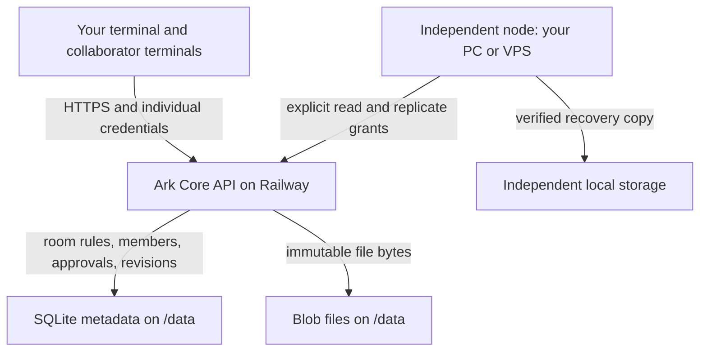
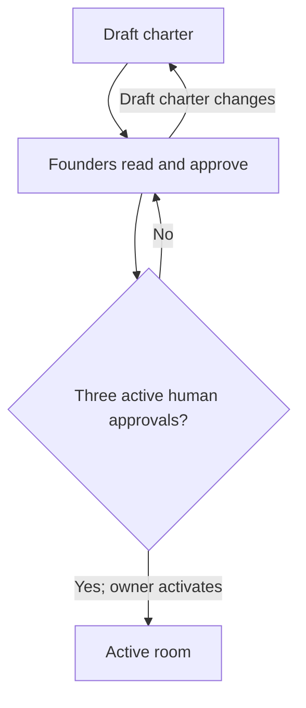

# Using Ark Core: from a charter to a shared room

October 5, 2026 · Ark Core 0.1 pilot

> “let's explore this nebula. Let's coalesce it into something that I can deploy” — Jah Noah, Q008

This guide describes the software that exists today. Your quoted words are human source excerpts from the October 5 conversation. Instructions, explanations and code are implementation documentation written by the assistant. Quotes were not independently checked against audio.

## Phone app added October 8

The personal editor is now live at https://ark-core-testing.up.railway.app/app/. See [PHONE-APP.md](PHONE-APP.md) for installation, access-file login and the new 5 GB personal archive. The room CLI walkthrough below remains valid for the earlier collaborative backend. Statements below about planned browser UI refer to room/course/community interfaces; the new personal writing app does not provide those.

## Start here

Ark Core is running at **https://ark-core-testing.up.railway.app**. It currently provides a backend API. You use it through a terminal or another server. The browser landing page displays service information; it does not yet offer sign-in, room creation forms, courses or chat.

The shortest useful path is: download the deployment package, load your operator credential, enroll two real collaborators, draft a room, add those collaborators, have all three people approve the same charter, activate the room, and upload one file.

No room has been created for you automatically. Three accounts are not evidence of three people; each founder needs to understand and approve the charter individually.

## The topology that is running

> “I- I want OnlyJah to be able to run lean” — Jah Noah, Q012



The Railway service is one node. Your computer can be another node with its own data directory. They talk over the API; they do not share a database file. A room is a logical workspace, not a server or a domain. Many rooms can live on a node. Adding a node does not make that node an owner of every room.

The 512 MB Railway volume holds the database and file objects. Individual files are limited to 1 MiB and the object store to 256 MiB in this pilot. These are implementation ceilings, not a storage subscription or production capacity promise.

| Word | What it means here |
|---|---|
| Node | One installation with a stable ID and its own storage. |
| Room | A workspace with a charter, owner and members. |
| Charter | The proposed room rules as text, retained as an immutable revision. |
| Identity | An individually enrolled human or service account. |
| Membership | A person's role inside a particular room. |
| Resource | A document or other named item inside a room. |
| Revision | A particular immutable version of a resource's bytes. |
| Replica | A deliberately stored recovery copy of one revision on another node. |
| Grant | An explicit, expiring permission for a particular resource. |

## 1. Open the package and check access

> “It's their portal to the internet.” — Jah Noah, Q013

Extract **Ark-Core-Railway-0.1.0.zip**. It contains `ark-core/` and `private-access/operator-access.json`. The latter is your private operator credential. Keep it out of public repositories and shared folders.

Open a terminal in the extracted `ark-core` directory. The guide's helper uses **Python 3's standard library**, with no pip install. Running a second node also requires **Node 24.19.x**.

Check the public health endpoint without credentials:

```sh
curl https://ark-core-testing.up.railway.app/health
```

Expected response:

```json
{"status":"ok"}
```

Read your node and rooms using the private credential file:

```sh
python3 examples/ark.py get ../private-access/operator-access.json /v1/node
python3 examples/ark.py get ../private-access/operator-access.json /v1/rooms
```

The deployment's node ID is `98cda62c-94a3-45fa-ab57-ad25388dae6f`. Initially the room list is `[]`. Unauthenticated `/v1` requests return **401**. If the credential has expired, request operator recovery before continuing; changing the bootstrap hash alone does not rotate an existing account.

The initial operator credential expires 30 days after first database initialization. Enrollment defaults to 24 hours; the examples below request seven days. Renewal/login UI is still planned.

## 2. Enroll people without sharing your operator credential

> “we already know each other. We know we're aligned in our mission, our vision, our purpose.” — Jah Noah, Q023

Your operator account can enroll identities. Room permissions remain separate: being the operator does not bypass another owner's room rules.

Enroll two actual collaborators, using their names instead of the sample labels:

```sh
python3 examples/ark.py enroll ../private-access/operator-access.json \
  "Collaborator A" ../private-access/collaborator-a.json --ttl 604800

python3 examples/ark.py enroll ../private-access/operator-access.json \
  "Collaborator B" ../private-access/collaborator-b.json --ttl 604800
```

The helper generates a random token locally, sends only its SHA-256 hash for enrollment, and stores the new person's credential in an owner-readable file. It prints the account ID and file path, never the token. Transfer each file privately to its intended person; they can adjust `public_url` only when deliberately moving to a different trusted installation.

If enrollment fails after sending, rerun the exact same enrollment command. A pending access file keeps its original token, body and operation ID, so the retry can obtain the same receipt. A completed output file will not be overwritten. Enrollment is not a human-verification protocol; the operator vouches for the person.

Actual enrollment code from `src/api.ts` is included later in this guide.

## 3. Draft your room and charter

> “you define the rules and scope of the room, and then you create it.” — Jah Noah, Q001

For this example, your operator account also creates the room and therefore owns this room. In ordinary use any enrolled human account can create a draft and becomes its owner.

```sh
python3 examples/ark.py post ../private-access/operator-access.json /v1/rooms \
  '{"name":"First shared project","charter":"Purpose: collaborate on one project. Members may read; editors may revise documents. Three distinct human members approve this exact charter before activation. Recovery copies require separate consent."}' \
  > room.json
```

Read the generated IDs without typing them again:

```sh
ROOM_ID="$(python3 -c 'import json; print(json.load(open("room.json"))["id"])')"
CHARTER_ID="$(python3 -c 'import json; print(json.load(open("room.json"))["charter_id"])')"
A_ID="$(python3 -c 'import json; print(json.load(open("../private-access/collaborator-a.json"))["identity_id"])')"
B_ID="$(python3 -c 'import json; print(json.load(open("../private-access/collaborator-b.json"))["identity_id"])')"
```

At this point it is a **draft**. Writing ordinary resource files is not yet allowed. The charter is a string in this version; arbitrary prose is not an executable policy language. The implemented rules are owner control, explicit memberships, three founding approvals, and resource permissions. Use charter text to record agreements, without assuming every sentence is enforced by software.

## 4. Add your collaborators

> “the person who created the room, like the owner of the room, is sovereign over the room” — Jah Noah, Q025

The room owner adds memberships. Use `reader` for someone who may read, or `editor` for someone who may upload/revise files:

```sh
python3 examples/ark.py post ../private-access/operator-access.json \
  "/v1/rooms/$ROOM_ID/members" \
  "{\"identity_id\":\"$A_ID\",\"role\":\"editor\",\"active\":true}"

python3 examples/ark.py post ../private-access/operator-access.json \
  "/v1/rooms/$ROOM_ID/members" \
  "{\"identity_id\":\"$B_ID\",\"role\":\"editor\",\"active\":true}"
```

The owner is already a member. Your additional collaborators can be enrolled and added in the same way. There is no automatic membership inheritance through parent projects in this pilot.

## 5. Each person reads and approves

> “three or more people are required to sign off on the creation of a room” — Jah Noah, Q002

First, each founder reads the current room and charter with **their own access file**:

```sh
python3 examples/ark.py get YOUR_ACCESS_FILE "/v1/rooms/$ROOM_ID"
```

`YOUR_ACCESS_FILE` is an explicit placeholder: replace it with that person's local credential-file path. Each collaborator needs the room ID and current charter ID; send those ordinary identifiers with the invitation.

After agreeing, **each person** runs:

```sh
python3 examples/ark.py post YOUR_ACCESS_FILE "/v1/rooms/$ROOM_ID/approve" \
  "{\"charter_id\":\"$CHARTER_ID\"}"
```

You use `../private-access/operator-access.json`; A uses their own collaborator file; B uses theirs. Do not collect their tokens and run approvals on their behalf. The automated tests simulate identities only in temporary local test data.

Then the room owner activates it:

```sh
python3 examples/ark.py post ../private-access/operator-access.json \
  "/v1/rooms/$ROOM_ID/activate" '{}'
```

Expected result contains `"status": "active"`. Fewer than three active human approvers yields **409**. A service account cannot sign. A draft charter edit creates a new charter ID and requires fresh approvals. Once active, its charter cannot be edited in this pilot.



## 6. Put a document in the room

> “a space that has whatever tools or technologies inside of it, whatever connections inside of it to other things that- that it needs in order to- to- to do its thing” — Jah Noah, Q016

Create a small file locally and upload it:

```sh
printf '%s\n' 'Our first shared planning document.' > planning.txt

python3 examples/ark.py upload ../private-access/operator-access.json \
  "$ROOM_ID" "Planning document" planning.txt > resource.json

RESOURCE_ID="$(python3 -c 'import json; print(json.load(open("resource.json"))["id"])')"
REVISION_ID="$(python3 -c 'import json; print(json.load(open("resource.json"))["revision_id"])')"
```

`upload` converts bytes to the API's canonical base64 representation. A successful receipt includes a resource ID, revision ID, and SHA-256 digest. The `document` kind describes the item; it does not launch a document editor.

Read metadata or download the exact revision:

```sh
python3 examples/ark.py get ../private-access/operator-access.json "/v1/resources/$RESOURCE_ID"
python3 examples/ark.py download ../private-access/operator-access.json \
  "$RESOURCE_ID" "$REVISION_ID" recovered-planning.txt
```

Downloads refuse to overwrite an existing destination. Active room members can read; the owner and editors can write. An unrelated account receives **403**.

## 7. Revise without overwriting someone else's edit

> “this file may be out of date, but we can always, you know, synchronize it” — Jah Noah, Q009

```sh
printf '%s\n' 'Our planning document, revised after discussion.' > planning-v2.txt

python3 examples/ark.py revise ../private-access/operator-access.json \
  "$RESOURCE_ID" "$REVISION_ID" planning-v2.txt > revision-v2.json
```

The new revision receipt uses `id` for the new revision ID. Old bytes remain available through their old revision ID. If another editor already advanced the head, your outdated `base_revision_id` receives **409**. Fetch the current resource, reconcile the edits, and submit against the new head. There is no automatic text merge or simultaneous collaborative editor yet.

Every POST has a retry identifier. The helper generates a fresh one unless you pass `--operation-id`. For a network retry, reuse one chosen ID and the exact same path/body:

```sh
python3 examples/ark.py post ../private-access/operator-access.json \
  "/v1/rooms/$ROOM_ID/activate" '{}' --operation-id YOUR_SAVED_OPERATION_ID
```

That example illustrates retry syntax, not a new activation after one already succeeded. A reused ID with different input returns **409**. Retrying with a different ID is a new operation and may create a second object.

## 8. Connect an independent node and copy one revision

> “Independent sites need to be connected right from the start” — Jah Noah, Q010
>
> “we have the file backed up across these different places” — Jah Noah, Q005

An independent node needs its own storage and a dedicated service credential on the source. It should not use your operator credential.

On the source, enroll a **service** identity:

```sh
python3 examples/ark.py enroll ../private-access/operator-access.json \
  "Personal node backup connector" ../private-access/personal-node-service.json \
  --kind service --ttl 604800

SERVICE_ID="$(python3 -c 'import json; print(json.load(open("../private-access/personal-node-service.json"))["identity_id"])')"
EXPIRES_AT="$(python3 -c 'import time; print(int(time.time()*1000)+3600000)')"
```

The owner of this resource separately grants **read** and **replicate**, here for one hour:

```sh
python3 examples/ark.py post ../private-access/operator-access.json \
  "/v1/resources/$RESOURCE_ID/grants" \
  "{\"identity_id\":\"$SERVICE_ID\",\"action\":\"read\",\"expires_at\":$EXPIRES_AT}"

python3 examples/ark.py post ../private-access/operator-access.json \
  "/v1/resources/$RESOURCE_ID/grants" \
  "{\"identity_id\":\"$SERVICE_ID\",\"action\":\"replicate\",\"expires_at\":$EXPIRES_AT}"
```

Create a private peer configuration from that service credential:

```sh
python3 examples/ark.py peer-config ../private-access/personal-node-service.json \
  98cda62c-94a3-45fa-ab57-ad25388dae6f ../private-access/peers.json --peer-name railway
```

On the destination PC/VPS, use the extracted code, that private peer config, and the source's resource/revision IDs. From `ark-core/`:

```sh
ARK_DATA=./personal-node-data node src/cli.ts replicate \
  ../private-access/peers.json railway "$RESOURCE_ID" "$REVISION_ID"
```

This initializes a **different** local node ID, fetches only the authorized revision, checks its byte count and digest, and records a replica receipt. It does not copy the entire source database or archive. The digest identifies bytes; it does not grant access.

The destination does not need to keep an HTTP server running just to obtain a copy. To run its own local API later:

```sh
ARK_DATA=./personal-node-data node src/cli.ts identity "Local operator" human admin 604800
ARK_DATA=./personal-node-data node src/cli.ts serve
```

The identity command prints a newly issued credential **once**; preserve that result privately. The default listener is `127.0.0.1:8080`, accessible only locally. Public operation requires its own HTTPS setup.

A replica is a local recovery object. It is not automatically a public resource, a course item, or another writable authority. Its bytes are at `personal-node-data/blobs/DIGEST`, using the digest from the receipt. Later changes require deliberately fetching a newer revision.

## 9. Remove access and understand what remains

> “all my projects are sovereign” — Jah Noah, Q007

The resource owner can revoke replication by setting its grant expiry to zero:

```sh
python3 examples/ark.py post ../private-access/operator-access.json \
  "/v1/resources/$RESOURCE_ID/grants" \
  "{\"identity_id\":\"$SERVICE_ID\",\"action\":\"replicate\",\"expires_at\":0}"
```

Revoke the `read` grant too if the connector should stop reading. A room owner can remove a member using the same membership endpoint with `active: false`. If that identity also has direct grants, those grants need separate revocation: membership and grants are distinct.

An operator can revoke all credentials of an account:

```sh
python3 examples/ark.py post ../private-access/operator-access.json /v1/admin/revoke \
  "{\"identity_id\":\"$SERVICE_ID\"}"
```

Revocation blocks future authorized retrieval. It cannot recall bytes already copied. Hosted operators and recipients with plaintext must be trusted; this pilot does not implement end-to-end encrypted rooms.

## 10. Export an independently hosted node

Stop or pause local writes for a closely matched backup. Use a new directory outside the data root:

```sh
ARK_DATA=./personal-node-data node src/cli.ts export ../personal-node-backup
```

Export snapshots the metadata database and copies immutable blobs. Protect the backup and keep it on an independent device. To restore, stop the server and point `ARK_DATA` at the exported directory. The original node ID is retained; do not run two live restored copies as separate independent identities.

This CLI operates on **local data**. Running it on your laptop does not export Railway's volume. Railway backup/export automation and a remote user export UI remain future work.

## 11. Follow room events

```sh
python3 examples/ark.py get ../private-access/operator-access.json \
  "/v1/rooms/$ROOM_ID/events?after=0"
```

Keep the last returned `sequence` and use it as the next `after` value. Each request returns at most 100 events. This is durable polling; it is not a WebSocket stream. The client must continue polling and handle access loss. Event-log retention/resnapshot is not implemented yet.

## Troubleshooting

| Result | Meaning / next action |
|---|---|
| 400 | Check fields, role, canonical base64, token hash, or expiry format. |
| 401 | Missing, expired or revoked credential; check the selected private access file. |
| 403 | Caller lacks membership/grant/owner/operator rights, or request carries a browser Origin header. |
| 404 | Check resource, room or route IDs. |
| 409 at activation | Need three currently active human approvers of this charter revision. |
| 409 at approval | Charter ID changed; reread and decide on the current revision. |
| 409 at file edit | Base revision is stale; fetch head and reconcile. |
| 409 at retry | Operation ID was reused with different input. |
| 413 | Request exceeds 1.5 MB or file exceeds 1 MiB. |
| 507 | Local unique file-object store reached its 256 MiB ceiling. |
| Enroll output exists | Completed credentials are protected from overwrite; use a new filename. Exact pending enrollments may be resumed. |

A web app currently cannot call this API from a normal browser origin: the server explicitly rejects Origin headers. The shipped TypeScript client is an interface sketch, not a working browser-login integration. Continue using the terminal/server path until established login, exact-origin checks and the room UI are added.

## What you can use now, and what is still ahead

> “when I add a new feature, I don't got to edit 15 different projects at once” — Jah Noah, Q006

| Available now | Planned, not included |
|---|---|
| Operator enrollment, owner-led rooms, memberships | Browser login and room-management UI |
| Three-founder activation and immutable active charter | Member-led / charter-executable governance, succession |
| File upload/read/revisions and conflict detection | Live shared document editing and merge tools |
| Explicit resource grants and verified recovery copies | Automatic peer discovery, signed node trust and remote memberships |
| Local node operation and snapshot/export | Scheduled backup/synchronization and remote export UI |
| HTTP polling and stored events | WebSockets, OSC, SPI and network-overlay adapters |
| Small documents and typed resource metadata | Course/forum UI, Matrix messaging, video playback/transcoding |
| Shared API/client boundaries | Shared frontend release channels and multi-site rollout |

Your shared-client idea remains the direction: one module implementation, independently configured sites, deliberate releases and rollback. The current pilot proves the permission/resource foundation; it does not yet update fifteen frontends automatically.

## Read the actual implementation

The excerpts below are copied from the current source files. No API keys or private data are included. Full source is in the deployment package; the local repository is on `main`. A GitHub repository has not yet been created.

### Authentication comes before room operations

Source: `src/api.ts`.

```typescript
      requireThat(!req.headers.origin, 403, 'browser origins are disabled in the pilot');
      const authorization = req.headers.authorization || '';
      requireThat(authorization.startsWith('Bearer '), 401, 'bearer credential required');
      const actor = store.authenticate(authorization.slice(7));
```

### Enrollment stores a hash, not the new secret

Source: `src/api.ts`.

```typescript
      requireThat(typeof b.token_hash === 'string' && /^[a-f0-9]{64}$/.test(b.token_hash), 400, 'SHA-256 token_hash required; generate a 32-byte random token locally');
      const id = randomUUID();
      s.run('INSERT INTO identities VALUES(?,?,?)', id, name, Number(b.human));
      s.run('INSERT INTO credentials VALUES(?,?,?,?,0)', b.token_hash, id, 0, Date.now() + ttl * 1000);
      return {id, name, expires_at: Date.now() + ttl * 1000};
    }
```

### Three approvals are counted on the current charter

Source: `src/api.ts`.

```typescript
    if (p[3] === 'activate' && p.length === 4) {
      s.manage(room.id,actor); requireThat(room.status==='draft',409,'room already active');
      const count=s.one(`SELECT COUNT(*) AS n FROM approvals a JOIN memberships m ON m.identity_id=a.identity_id AND m.room_id=?
        JOIN identities i ON i.id=a.identity_id WHERE a.charter_id=? AND m.active=1 AND i.human=1`,room.id,room.charter_id).n;
      requireThat(count>=3,409,'three active human approvals required');
      s.run('UPDATE rooms SET status=? WHERE id=?','active',room.id);
      s.event(room.id,actor.id,'room.activated',room.id); return {id:room.id,status:'active'};
    }
```

### A stale edit cannot overwrite a newer head

Source: `src/api.ts`.

```typescript
      // Jah Noah [Q009]: "this file may be out of date, but we can always, you know, synchronize it"
      // Engineering: a stale edit gets a conflict; no silent overwrite or last-write-wins.
      requireThat(b.base_revision_id===r.head,409,'revision conflict; fetch current head and reconcile');
```

### The second node verifies source and byte integrity

Source: `src/peer.ts`.

```typescript
  requireThat(envelope.protocol===1 && envelope.node_id===peer.node_id && envelope.resource_id===resourceId,502,'unexpected peer identity or resource');
  const revision=envelope.revision;
  requireThat(revision && revision.resource_id===resourceId && typeof revision.id==='string' && (!revisionId || revision.id===revisionId),502,'unexpected revision');
  requireThat(typeof envelope.content_base64==='string',502,'missing content');
  const bytes=Buffer.from(envelope.content_base64,'base64');
  requireThat(bytes.length<=1048576 && revision.size===bytes.length && digest(bytes)===revision.digest,502,'replica integrity failure');
```


## Useful files in the package

| Path | Purpose |
|---|---|
| `examples/ark.py` | The terminal helper used throughout this guide. |
| `docs/USER-GUIDE.md` | This manual, with topology and source excerpts. |
| `docs/API.md` | All implemented routes and request shapes. |
| `docs/RAILWAY.md` | Deployment IDs, access/expiry and recovery limits. |
| `docs/STATUS.md` | Implemented versus planned ledger. |
| `src/api.ts` | Actual room, identity, grants and revision handlers. |
| `src/store.ts` | Schema, credential checks, transactions and blob storage. |
| `src/peer.ts` | Deliberate remote-copy logic. |
| `railway/ark-core.function.ts` | Generated code deployed to Railway. |
| `test/core.test.ts` | Five-person/two-node behavior and restore tests. |
| `quotes/catalog.json` | Forty exact quote excerpts with stable IDs. |

From the repository root:

```sh
npm test
npm run check:quotes
```
